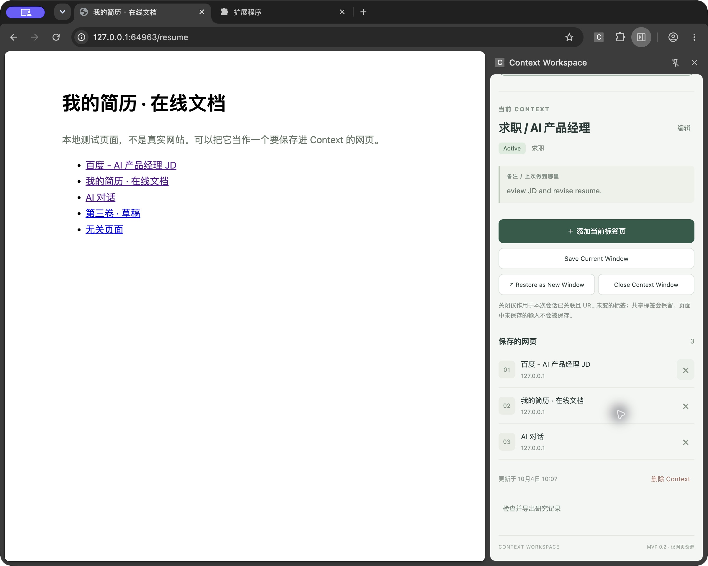
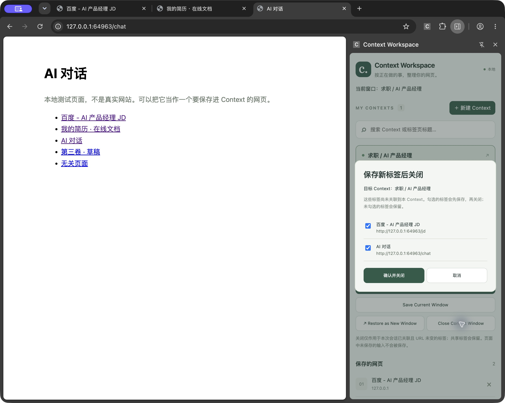
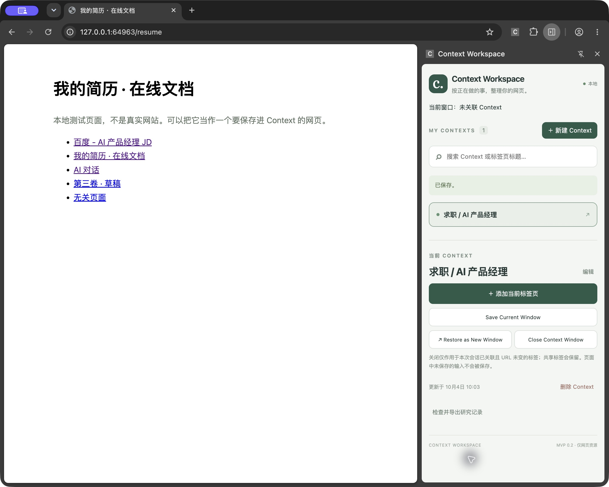

# Context Workspace 人工验收记录

验收日期：2026-10-04  
验收版本：扩展管理页显示 `0.2.0`  
项目：`/Users/miti/Desktop/context-workspace`

> **2026-10-09 补验更新：B3 已通过。** 实体鼠标完成真实侧栏拖动，最窄 360px、再次拉宽 1078px 均可用。详见 [B3 补验报告与 8 张截图](../manual-acceptance-B3-2026-10-09/README.md)。以下保留 10 月 4 日当时的结果与边界。

## 10 月 4 日当时结论

**10 个检查项中，9 项通过；B3 未完成验证。没有确认的功能失败项，但本次验收不能视为全部通过。**

> 同日下午已根据下面的初次使用反馈改了文案：三个英文操作改为「保存当前窗口」「恢复为新窗口」「关闭 Context 窗口」，未绑定窗口的说明不再写成「未关联 Context」，关闭说明改成一句人话。本记录仍描述改动前的界面，按钮名称保持当时原文。

工具栏入口正常，真实 Side Panel 在 360 CSS 像素宽度下可用，保存、独立窗口恢复、新增标签勾选、无新增标签直接关闭、仅显示名称等流程均完成了桌面 UI 操作检查。**B3「拖到最窄，再拉宽」仍需补验**：多次拖动未产生宽度变化，无法排除桌面控制工具的影响，不能据此判定扩展有缺陷。

侧边栏和后台 Service Worker 控制台均没有报错。另发现 DevTools Issues 的表单字段改进提示，详见下文。

本文件与 `screenshots/` 应一起保留；截图均为本次验收的真实窗口截图，Markdown 中使用相对链接，整个文件夹可直接复制给其他人。

## 验收范围与环境

- 验收方式：通过桌面 UI 控制工具执行点击、输入、滚动、窗口切换及 DevTools 检查。没有用普通标签页渲染代替真实 Side Panel 验收。
- 用户告知自动化测试已全部通过；本次没有重跑自动化测试，也没有审查或修改扩展实现。
- 使用用户指定的启动命令：

  ```sh
  cd /Users/miti/Desktop/context-workspace
  node tests/manual-check.mjs
  ```

- 实际启动的应用：Google Chrome for Testing，独立临时配置。
- 本次扩展 ID：`lojgoomapjbgjgjlogcokipjhadniedg`。
- 本次本地测试地址：`http://127.0.0.1:64963`。端口由脚本临时分配，下次启动必须重新读取输出。
- 初始沙箱启动遇到本地监听权限限制，获准后重新启动成功；这不是扩展功能失败。
- 验收结束时，启动进程与原测试窗口仍保持运行，未主动结束。此项是当时状态，不保证日后阅读时仍在线；窗口关闭后临时数据会清理，截图和本记录仍保留。
- 未记录源码提交 SHA，结论仅对应当次实际加载的构建。

## 逐项结果

| 项目 | 结果 | 实际观察与边界 | 证据 |
| --- | --- | --- | --- |
| A1 拼图菜单打开 | 通过 | 点击拼图菜单里的 Context Workspace，真实 Chrome 侧边栏打开并显示扩展界面。 | [初始侧边栏](screenshots/B-default.png) |
| A2 固定图标开关 | 通过 | 在拼图菜单点击图钉固定；点击工具栏扩展图标可以关闭、重新打开侧边栏。 | 操作过程观察；[固定后侧边栏](screenshots/B-with-pages.png) |
| B1 实际宽度 | 通过 | 在真实侧边栏的 DevTools 中测得 `innerWidth = 360`、`document.documentElement.scrollWidth = 360`、`devicePixelRatio = 2`。即 360 CSS px，对应截图中 720 图像像素的内容宽度。 | [测量结果](screenshots/B-width-console.png) |
| B2 布局 | 通过 | 在所测 360px 宽度下，没有横向滚动条、明显文字截断、按钮重叠或元素溢出；检查了空状态、已保存页面的详情、资源列表及仅名称状态。内容较长时通过纵向滚动查看。 | [空状态](screenshots/B-default.png)、[详情上部](screenshots/B-with-pages.png)、[资源列表](screenshots/B-sidepanel-resources.png) |
| B3 最窄与拉宽 | 没做（未完成验证） | 多次尝试拖动内侧分隔线，宽度始终没有变化。没有取得最窄宽度或拉宽后的有效结果；无法区分是桌面控制工具限制还是浏览器调整行为，不能标记通过或认定扩展失败。 | 只有 360px 状态截图，没有有效的宽度变化证据 |
| C 新建与保存两页 | 通过 | 新建「求职 / AI 产品经理」，通过「＋ 添加当前标签页」分别保存 JD、简历，数量变为 2。 | [保存两页后](screenshots/B-with-pages.png) |
| D 恢复独立新窗口 | 通过 | 点击「↗ Restore as New Window」后，新窗口含 JD、简历两个标签；窗口菜单确认原窗口仍存在。 | 操作过程观察；未单独保存窗口菜单截图 |
| E 新增标签勾选清单 | 通过 | 在恢复窗口用新标签按钮打开本地 AI 对话页，点击「Close Context Window」后出现清单；勾选确认后保存页面并关闭任务窗口。 | [勾选清单](screenshots/E-save-checklist.png) |
| F 无新增标签直接关闭 | 通过 | E 的确认操作已关闭任务窗口，因此再次恢复全部已保存页面，保持无新增、无导航改动；打开侧边栏后点击「Close Context Window」，任务窗口直接关闭，没有确认框。原窗口仍保留。 | 操作过程观察；此项验证通过 |
| G 只显示名称 | 通过 | 编辑并勾选「只显示名称」后，分类、状态文字、备注、网页数量、资源标题和 URL 都隐藏。操作按钮、关闭说明、更新时间仍保留；通过结论针对用户指定的隐藏字段。 | [仅名称状态](screenshots/G-name-only.png) |

**A 项的备用对照页没有打开。** 因为 A1、A2 正常，不需要通过普通标签页对照排查工具栏入口。

## 操作细节与原始界面文案

没有确认的失败项，因此没有失败提示文案或失败截图。以下保留与判断有关的原文，方便后续定位与复核；不要把这些成功提示当作报错。

保存当前页面后的提示：

> 当前网页已保存并关联；同一 Context 内相同 URL 不重复保存。

新增标签清单的标题、说明和按钮：

> 保存新标签后关闭

> 这些标签尚未关联到本 Context。勾选的标签会先保存，再关闭；未勾选的标签会保留。

> 确认并关闭

> 取消

E 的截图中清单同时出现 JD 和 AI 对话。验收时曾在 JD 标签上导航到 AI 对话后返回，随后才另外新建 AI 对话标签；因此该截图包含受导航影响的 JD 候选项。**这不是“清单仅列出一个新增标签”的纯净用例**，E 的通过依据是新增 AI 对话被列入可勾选清单，并能保存后关闭。F 另用重新恢复、未发生导航变更的窗口独立验证。

输入工具在中文输入和剪贴板恢复时曾产生内容偏差，之后修正了测试内容；截图中的英文备注 `eview JD and revise resume.` 是测试数据，不作为扩展输入缺陷。后续验收可使用自己新建的测试数据复现流程。

G 验证后，为补拍资源列表，已取消「只显示名称」并保存；因此最终资源列表截图显示 3 个页面，而 G 的截图显示隐藏状态，两者是先后不同的验收阶段。

## 控制台与 DevTools Issues

| 检查对象 | 结果 | 截图 |
| --- | --- | --- |
| 真实 Side Panel 控制台 | **没有报错**。最终检查显示 `0 messages in console`。 | [侧边栏控制台](screenshots/console-sidepanel-final.png) |
| 后台 Service Worker 控制台 | **没有报错**。从 `chrome://extensions` 的 `Service Worker` 链接打开，上下文为 `background.js`，显示 `0 messages in console`。 | [后台控制台](screenshots/console-service-worker.png) |

上述结论指本次打开控制台时可见的记录；没有声称进行了覆盖整个会话的持续日志采集。

侧边栏 DevTools Issues 最终显示 **0 page errors、0 breaking changes、13 possible improvements**。改进提示原文为：

```text
A form field element should have an id or name attribute
```

[查看 Issues 截图](screenshots/devtools-issues.png)。这属于表单字段属性改进提示，没有按运行时控制台错误计入失败项。

## 初次使用者的主观感受

最困惑的是已经看到“当前网页已保存并关联”，顶部却仍显示“当前窗口：未关联 Context”，不容易理解网页关联和窗口关联的区别。关闭按钮旁关于“本次会话”“URL 未变”“共享标签”的说明需要反复读，才能判断到底会关闭哪些页面。中文界面中几个关键操作突然切换成英文，也增加了理解成本。

以上属于体验反馈，尚未作为功能缺陷确认。

## 留给下一位验收者

1. **优先补验 B3**：使用实际鼠标拖动真实 Side Panel 内侧边缘，分别停在最窄和较宽状态；记录 CSS 像素宽度，并保存两个状态的截图。
2. 在最窄状态检查 Context 编辑表单、详情操作按钮、资源列表和新增标签清单能否完整使用；不要用普通标签页缩窄来替代。
3. 如发现失败，原样记录提示文案、截图、侧边栏和后台控制台错误，再更新本记录。若没有失败提示，明确记录“没有界面错误提示”。
4. 表单字段 `id` / `name` 提示和中英文文案一致性，可另作后续改进；本次没有修改实现。

## 截图索引

| 文件 | 内容 |
| --- | --- |
| [B-default.png](screenshots/B-default.png) | 工具栏打开后的真实侧边栏空状态 |
| [B-with-pages.png](screenshots/B-with-pages.png) | 保存两个网页后的侧边栏详情上部 |
| [B-width-console.png](screenshots/B-width-console.png) | 360px 视口、360px 滚动宽度及倍率 2 的测量结果 |
| [B-sidepanel-resources.png](screenshots/B-sidepanel-resources.png) | 真实侧边栏详情下部、操作按钮与三个已保存网页 |
| [E-save-checklist.png](screenshots/E-save-checklist.png) | 关闭前的新增/未关联标签勾选清单 |
| [G-name-only.png](screenshots/G-name-only.png) | 仅名称显示结果 |
| [console-sidepanel-final.png](screenshots/console-sidepanel-final.png) | 最终侧边栏控制台无报错 |
| [console-service-worker.png](screenshots/console-service-worker.png) | 后台 Service Worker 控制台无报错 |
| [devtools-issues.png](screenshots/devtools-issues.png) | 表单字段缺少 id/name 的改进提示 |

### 真实 Side Panel 预览



### 新增标签清单预览



### 只显示名称预览


