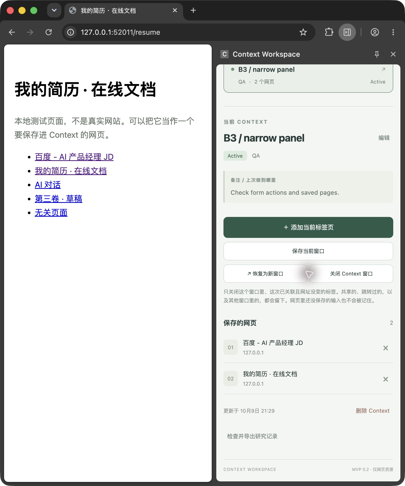
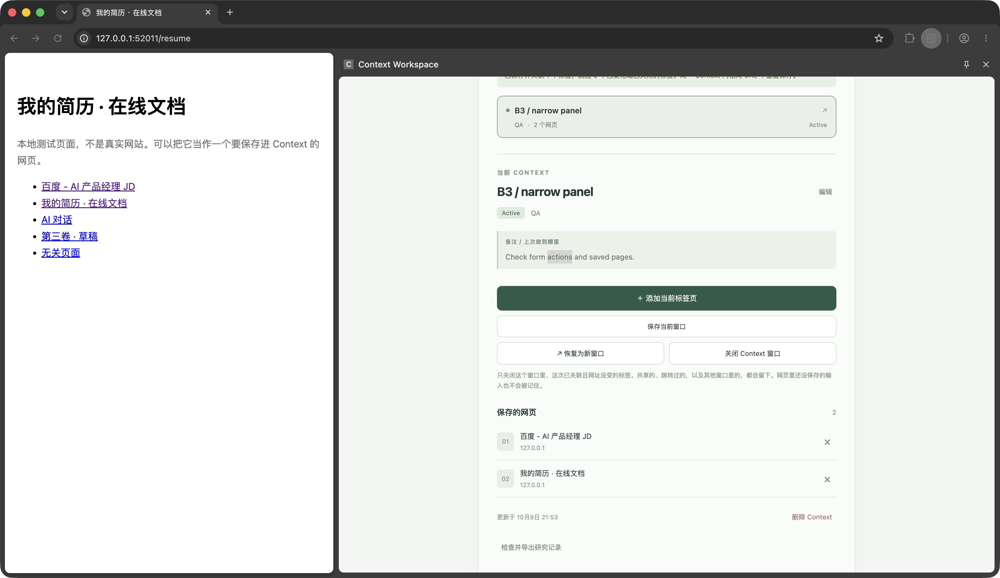

# B3 真实 Side Panel 宽度补验 · 2026-10-09

## 结论

**B3：通过。** 已在真实 Chrome Side Panel 中完成拉宽、缩至本次浏览器允许的最窄位置、再拉宽。最窄时为 **360 CSS px**，第一次拉宽为 **710 CSS px**，再次拉宽为 **1078 CSS px**；对应 `scrollWidth` 与 `innerWidth` 相等，没有横向溢出。

本轮由用户用实体鼠标拖动 Chrome 内侧分隔线，Codex 通过桌面 UI 完成表单、网页保存、滚动、勾选操作、DevTools 测量及截图。桌面工具自己的拖动多次未生效，未据此判定扩展失败。最窄边界依据用户“已到最窄”的确认与随后测得的 360px，不宣称所有 Chrome 版本和设备都使用这个下限。

结合 10 月 4 日原清单另外 9 项的通过记录，原清单全部 10 项现已有通过证据；**这不是本轮重新跑完 A1–G 的声明**。产品仍为 MVP，数据备份等已知限制不因 B3 通过而改变。

## 环境与可追溯性

- 项目：`/Users/miti/Desktop/context-workspace`。
- 基准提交：`d29cee0bf2742c49d94827b91aa33af9807aa262`，扩展版本 0.2.0；本轮未修改产品代码或安装包。
- 启动：`node tests/manual-check.mjs`，Google Chrome for Testing 独立临时配置；通过扩展菜单打开真实 Side Panel，没有使用普通扩展标签页代替。
- 扩展 ID：`lojgoomapjbgjgjlogcokipjhadniedg`。
- 本轮本地测试地址：`http://127.0.0.1:52011`，页面均为测试数据。
- 浏览器外框尺寸也曾调整，但下表宽度来自侧栏自身 DevTools，不是外框宽度或按截图猜测。
- 设备像素比为 2；表中使用 CSS 像素。截图中的内容宽度对应其两倍图像像素。

## 宽度与布局

| 阶段 | innerWidth | scrollWidth | 观察 |
| --- | ---: | ---: | --- |
| 首次拉宽 | 710 | 710 | 新建表单展开，标签、输入框、保存/取消按钮正常。 |
| 缩至最窄 | 360 | 360 | 表单、详情按钮、备注和网页列表均可用；无横向滚动条、按钮重叠或重要文字遮挡。 |
| 最窄后再次拉宽 | 1078 | 1078 | 两条资源和操作按钮完整显示，内容区域居中且宽度受限，原数据保留。 |

在每一状态的真实侧栏中右键“检查”，打开独立 DevTools Console 执行只读测量：

```js
JSON.stringify({width:innerWidth,scrollWidth:document.documentElement.scrollWidth,dpr:devicePixelRatio})
```

原始结果分别为：

```text
{"width":710,"scrollWidth":710,"dpr":2}
{"width":360,"scrollWidth":360,"dpr":2}
{"width":1078,"scrollWidth":1078,"dpr":2}
```

## 最窄状态的实际操作

| 检查 | 结果 | 证据 |
| --- | --- | --- |
| 新建表单及保存 | 通过 | 在最窄状态保存 `B3 / narrow panel`，名称、分类、备注与按钮完整可见。 |
| 添加当前标签页 | 通过 | 分别访问本地 JD、简历并保存，列表显示 2 个网页。 |
| 详情、按钮、列表与滚动 | 通过 | 可纵向滚动至详情和资源；按钮没有重叠，标题、域名、移除入口可见。 |
| 保存当前窗口清单 | 通过 | 标题、完整测试 URL、复选框、确认/取消按钮可见；取消勾选时确认按钮禁用，再勾选后确认保存成功。 |
| 再次拉宽 | 通过 | 用户再次拖宽，实测 1078px，资源及按钮保持正常，无横向溢出。 |

成功提示原文（不是报错）：

> Context 已创建。

> 当前网页已保存并关联；同一 Context 内相同 URL 不重复保存。

> 已保存并关联 1 个标签，跳过 0 个已变化或已关闭的标签。同一 Context 内相同 URL 不重复保存。

没有发现失败项，**没有界面错误提示**。本轮清单布局验证使用“保存当前窗口”，未重新执行关闭前新增标签的完整 E 流程；E 的真人验收结果保留在原报告。

## 控制台与限制

- **侧边栏控制台没有报错。** 打开 Console 时显示 `0 messages in console`；随后只出现上述测量命令及正常结果。此结论针对检查时可见记录，不是全会话持续日志采集。
- 后台 Service Worker 控制台本轮未重新检查；10 月 4 日人工验收已记录“没有报错”，不能将旧结论伪装成本轮检查。
- 保持测试启动进程与浏览器运行，未主动结束；这是交付时状态，不保证日后仍在线。
- 未改动产品源码，因此无需替换 v0.2.0 安装包；此次 GitHub 更新仅涉及验收材料和发布说明。

## 截图

| 文件 | 内容 |
| --- | --- |
| [wide-form.jpg](screenshots/wide-form.jpg) | 首次拉宽后的真实侧栏新建表单。 |
| [wide-width-console.jpg](screenshots/wide-width-console.jpg) | 710px 测量。 |
| [minimum-form.jpg](screenshots/minimum-form.jpg) | 最窄时填写好的表单。 |
| [minimum-resources.jpg](screenshots/minimum-resources.jpg) | 最窄时详情、操作按钮与两条资源。 |
| [minimum-checklist.jpg](screenshots/minimum-checklist.jpg) | 最窄时可操作的勾选清单。 |
| [minimum-width-console.jpg](screenshots/minimum-width-console.jpg) | 360px 测量。 |
| [wide-again-resources.jpg](screenshots/wide-again-resources.jpg) | 最窄后再次拉宽，内容和资源保持正常。 |
| [wide-again-width-console.jpg](screenshots/wide-again-width-console.jpg) | 1078px 测量。 |




